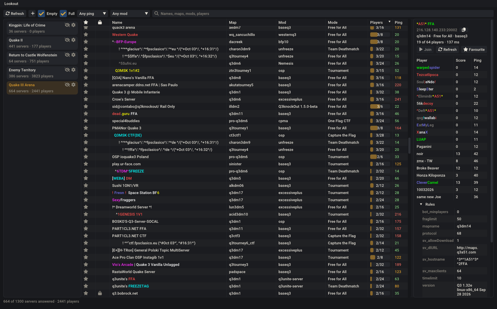
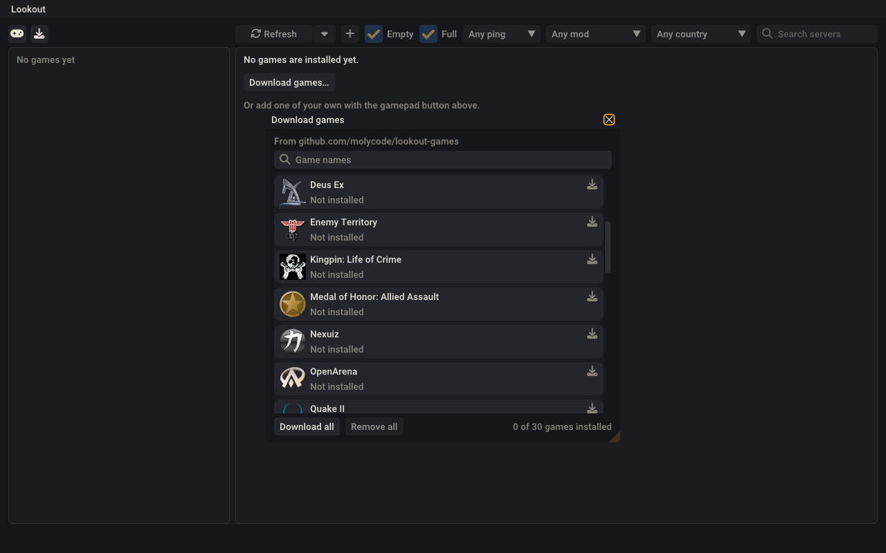

# Lookout

A native game server browser for Linux and Windows. It lists the servers from each game's masters, filters and sorts
them, shows who is playing, and joins with a double-click through the game's own launcher.

Lookout knows no game by itself. Each game is a description and each query protocol a sandboxed Lua script, downloaded
from [lookout-games](https://github.com/molycode/lookout-games) or written by you, so adding a game, even one still in
development, needs no new Lookout.



## Games

A game is a description, `games/<key>/game.json`, and a protocol a Lua script, `protocols/<name>.lua`. The published
ones are in [lookout-games](https://github.com/molycode/lookout-games), which Lookout downloads, updates and removes
from the download button above the game list (or `lookout --download`), into `~/.local/share/lookout/downloaded/` (or
`$XDG_DATA_HOME/lookout/downloaded/`; on Windows `%APPDATA%\Lookout\downloaded\`), checking each file against the
repository's index. Yours go in `~/.local/share/lookout/` (`%APPDATA%\Lookout\`), where a description under a downloaded game's key changes only what it names, so it survives
the game's updates. In the app, click the pencil on a game to edit its description, or click the gamepad above the game
list to add one; Lookout checks it as you type and reloads the games whenever that folder changes. The editor tests each
master as you open and edit it: a check with the number of servers it listed, or a cross with the reason. A protocol of
yours replaces the downloaded one of its name; Download games, a game's editor and its settings name the protocol in use
and the downloaded one's version. When games need a newer Lookout, Download games names it and links to its release. The
icon at the right of the menu bar says whether a newer Lookout is out; Lookout asks GitHub at start and once a day.
`lookout --check <folder>` checks a lookout-games folder before a pull request.



## Installing

On Linux, unpack `lookout-<version>-x86_64.tar.xz` from the [releases](https://github.com/molycode/lookout/releases)
and run its `install.sh`, which installs to `~/.local`. On Windows 10 22H2 or 11 (64-bit), run
`lookout-<version>-x86_64-setup.exe`, which installs for you alone, needs no administrator rights, and can put
`lookout` on your PATH for the command line. Both come with a README on where Lookout keeps its files and how to
uninstall it.

## Building

Needs CMake 4.3 or newer, Ninja, and GCC 14+ or Clang 19+ on Linux, Visual Studio 2026's C++ tools (MSVC, or its
clang-cl) on Windows.

```bash
cmake --preset linux-gcc-release
cmake --build --preset linux-gcc-release
./build/gcc-Release/lookout
```

On Windows, from an x64 Native Tools prompt, `cmake --preset windows-msvc-release` and `cmake --build --preset
windows-msvc-release` build `build\msvc-Release\lookout.exe` (the window) and `lookout.com` (the command line).

The first configure fetches the submodules and Mbed TLS's release tarball, checked against its published
SHA-256. `tools/build-release.sh` builds the distributable binary in a
container, so that it runs on Ubuntu 22.04, Debian 12 and anything newer. `tools/make-package.sh` then wraps it into
`dist/lookout-<version>-x86_64.tar.xz`, with a menu entry, an icon and an `install.sh` that installs to `~/.local`.
On Windows, `tools/windows/build-release.ps1` builds both programs with the C runtime linked in, and
`tools/windows/make-installer.ps1` wraps them with [NSIS](https://nsis.sourceforge.io) into
`dist/lookout-<version>-x86_64-setup.exe`.

## Code signing policy

Free code signing provided by [SignPath.io](https://about.signpath.io/), certificate by
[SignPath Foundation](https://signpath.org/).

- Committers and reviewers: [moly](https://github.com/molycode)
- Approvers: [moly](https://github.com/molycode)

Only Lookout's own Windows programs are signed: `lookout.exe`, `lookout.com`, the uninstaller and the setup of each
release. They are built from the release's tagged source by this repository's
[release workflow](https://github.com/molycode/lookout/blob/windows-port/.github/workflows/release.yml) on GitHub's
runners, and each signing request is approved by hand. The libraries Lookout uses are open source and compiled into
those programs from the sources this repository names; their licences are under Lookout > About Lookout > Licences.
Linux packages are not signed; each release lists its SHA-256.

### Privacy

Lookout collects no data about you or how you use it. It connects to other systems only for these, and each request
names Lookout and its version (`Lookout/<version> (+https://github.com/molycode/lookout)`), no account, no identifier:

- **Game servers.** When a game's server list is shown or refreshed, Lookout asks the master servers its description
  names for their lists, and each server listed for its status, as any server browser does. Each of them sees your IP
  address, as every connection shows it. Joining a server starts the game, which connects as it would by itself.
- **lookout-games.** Download games and `lookout --download` read the games' index, files and icons from GitHub
  (`raw.githubusercontent.com`). On a first start with no games, Download games opens by itself and reads the index.
- **New versions.** Lookout asks GitHub (`api.github.com`) for its latest release at start and once a day; Lookout 1.6
  adds a switch for it, in the installer and in Lookout.

Settings, logs and your own games stay on your machine.

## License

MIT — see `LICENSE`.

Downloads use [Mbed TLS](https://github.com/Mbed-TLS/mbedtls), under the Apache License 2.0. Country data:
[IP Geolocation by DB-IP](https://db-ip.com), under CC BY 4.0. Flags from
[flag-icons](https://github.com/lipis/flag-icons), under the MIT License.

The games' icons are not Lookout's: each comes with an `icon-licence.txt` giving its source and licence, and the games'
names and marks belong to their owners.
